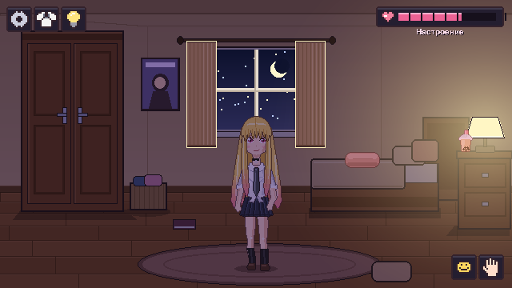
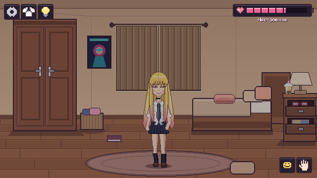

# Pixel Room (Open Alpha `v0.1-alpha`)

A cozy 16-bit interactive pixel-art desktop room & companion built with Python + Pygame-CE (native `640×360` with crisp Nearest-Neighbor `2x`/`3x` scaling and multi-layer spring-damper physics).

> **Download Windows Standalone `.exe` (No Python required):** grab `PixelRoom.exe` directly from the **[Releases](../../releases)** tab!

---

## Screenshots

| Cozy Evening & Lamp Glow | Closed Curtains & Interactive Drawers | Dark Night (Sleepy Mode) |
| :---: | :---: | :---: |
|  |  |  |

---

## Controls

- **LMB (Drag / Pull / Toss):** grab & toss Marin, pull her arms, hair strands, tie, skirt, or cheek like elastic springs, throw the bed pillow, or drag the bubble tea to her face.
- **RMB (Hold & Move on Head):** gentle headpat — her head tilts toward your cursor, eyes close happily, hearts float up, and mood rises.
- **Click Room Objects:** toggle window **curtains** (dims daylight / triggers sleepy mode in pitch-dark night), **table lamp**, **wardrobe** (3 outfits), **wall poster** (3 designs), **nightstand drawers**, **laundry basket**, and **floor manga**.
- **Corner Icons:** Settings (physics intensity `0–150%`, volume, *Always on Top*, window scale, Reset Pose), Wardrobe, Lighting, 8-Emotion switcher, and Wave.

---

## Features

- **16/32-bit High-Bit Pixel Art (`640×360`):** procedurally generated layered PNG sprites with multi-tone shading and selective colored outlines (*sel-out*).
- **Pivot-Rotation & Squash-Stretch Spring Physics:** hair strands, bangs, tie, skirt, shirt folds, arms, and head rotate around anatomical pivots with damped spring oscillations and elastic landing squash.
- **3 Outfits:** School Uniform, Home Tied Shirt & Shorts, and Oversized Pastel Hoodie.
- **8 Facial Expressions:** confident half-smile, happy headpat, blush, smug, surprised, sleepy/yawning, pout, and starry-eyed delight, plus smooth mouse-tracking pupils & blinking.
- **Interactive Room:** sliding curtains, dynamic day/sunset/evening/dark lighting, throwable pillow, drinkable bubble tea, swappable posters, and openable drawers.

---

## Run from Source

```bash
pip install -r requirements.txt
python generate_assets.py
python pixelroom.py
```

To build a single-file Windows `.exe`:

```bash
python build.py
```
