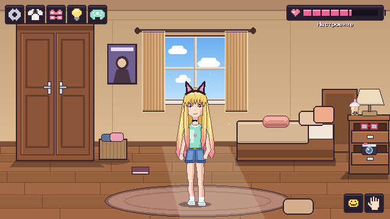
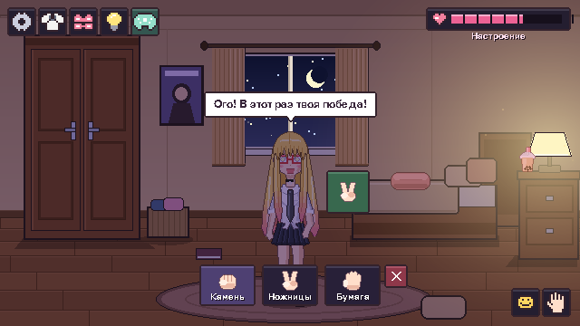
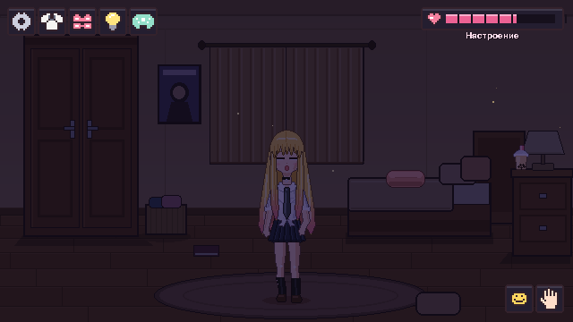

# Pixel Room — Marin Kitagawa (`v0.2-beta`)

A cozy 16-bit interactive pixel-art desktop room & companion featuring **Marin Kitagawa** from *My Dress-Up Darling* (*Sono Bisque Doll wa Koi wo Suru*), built with Python + Pygame-CE (native `640×360` with crisp Nearest-Neighbor `2x`/`3x` scaling, *sel-out* colored outlines, and clamped multi-layer spring-damper physics).

> **Download Windows Standalone `.exe` (No Python required):** grab `PixelRoom.exe` directly from the **[Releases](../../releases)** tab!
>
> *Unofficial non-commercial fan project. Marin Kitagawa and My Dress-Up Darling belong to Shinichi Fukuda / Square Enix.*

---

## Screenshots

| Summer Outfit, Cat Ears & Drawer Items | Rock-Paper-Scissors & Evening Lamp | Closed Curtains & Dark Sleepy Mode |
| :---: | :---: | :---: |
|  |  |  |

---

## Controls

- **LMB (Drag / Pull / Toss):** grab & toss Marin, pull her arms, hair strands, tie, skirt, or cheek like elastic springs, throw the bed pillow, feed bubble tea, or drag **cosplay glasses** & the **retro camera** out of the nightstand drawers!
- **RMB (Hold & Move on Head):** gentle headpat — her head tilts toward your cursor, eyes close happily, hearts float up, and mood rises.
- **Click Room Objects:** smoothly slide window **curtains**, toggle the **table lamp**, open the **wardrobe** (4 outfits), swap **wall posters** (3 designs), open **nightstand drawers**, bounce the **laundry basket**, or flip the **floor manga**.
- **Corner Icons:** Settings (physics `0–150%`, volume, *Always on Top*, window scale, Reset Pose, Reset Progress), Wardrobe (4 outfits), Accessories (Cosplay Glasses / Cat Ears), Lighting, **Rock-Paper-Scissors Minigame**, 8-Emotion switcher, and Wave.

---

## What's New in `v0.2-beta`

- **Visual Juice & Smooth Lerp:** real-time smooth transitions for sliding curtains and room lighting/sky crossfades (Day → Sunset → Evening Lamp → Pitch Dark), dynamic height-scaled floor shadows under Marin/pillow/boba, floating daylight dust motes in window sunbeams, and warm glowing micro-sparkles around the evening lamp.
- **Lively Idle Animations:** gentle shoulder/hair breathing, occasional natural weight-shifting, blinking, and spontaneous idle glances or hair-strand adjustments.
- **4th Outfit + Wearable Accessories:** added a **Summer Casual** outfit (mint top, blue denim shorts with belt, white sneakers) alongside School Uniform, Home Outfit, and Oversized Hoodie — plus wearable **Cosplay Glasses** and a **Cat-Ear Headband**.
- **Draggable Drawer Items:** open the nightstand drawers to pull out **Cosplay Glasses** (hand them to Marin to put on) or a **Retro Camera** (bring it to Marin for a selfie with full-screen flash & shutter SFX!).
- **Rock-Paper-Scissors Minigame:** play quick rounds directly in the room with animated countdown, 16-bit gesture icons, win counter, reactions, and mood rewards.
- **Auto-Save (`save.json`) & Clean Modular Architecture:** automatically saves outfit, accessory, mood, room lighting/curtains/poster, volume, window scale, and *Always on Top* next to `PixelRoom.exe`, plus a 2-step **Reset Progress** button in Settings. Refactored into clean modules (`physics.py`, `room_objects.py`, `particles.py`, `audio_engine.py`, `save_manager.py`, `ui_manager.py`).

---

## Run from Source

```bash
pip install -r requirements.txt
python generate_assets.py
python pixelroom.py
```

To build a single-file Windows `.exe`:

```bash
python build.py
```
