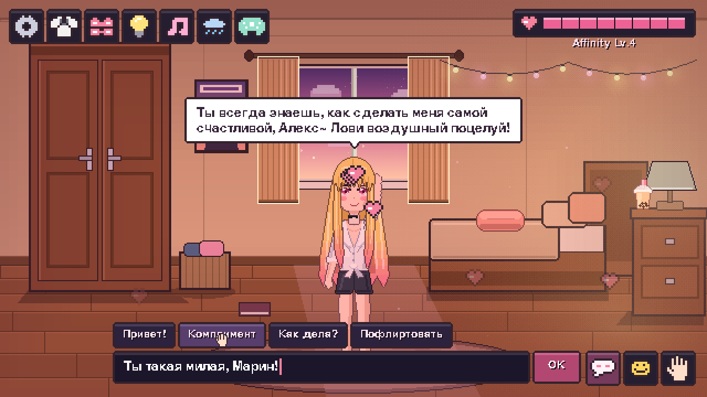
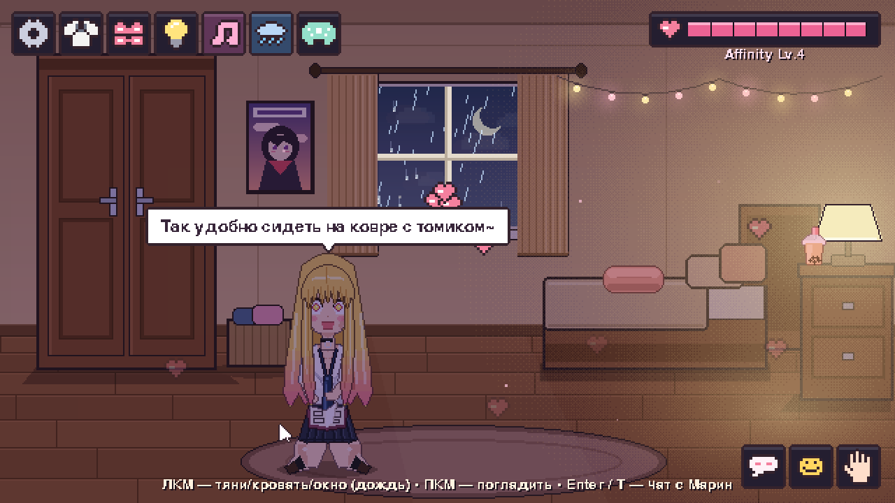
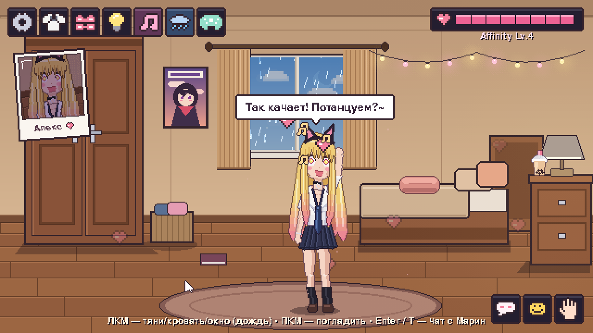

# Pixel Room — Marin Kitagawa (`v0.5-beta` — Alive, Cute & Chat Update)

A cozy 16-bit interactive pixel-art desktop room & companion featuring **Marin Kitagawa** from *My Dress-Up Darling* (*Sono Bisque Doll wa Koi wo Suru*), built with Python + Pygame-CE (native `640×360` with pixel-perfect DPI-aware Nearest-Neighbor `1x`/`2x`/`3x` scaling, *sel-out* colored outlines, Bayer-dithered lighting, offline Russian/English Chat, Cozy Rain weather, and clamped multi-layer spring-damper physics).

> **Download Windows Standalone `.exe` (No Python required):** grab `PixelRoom.exe` directly from the **[Releases](../../releases)** tab!
>
> *Unofficial non-commercial fan project. Marin Kitagawa and My Dress-Up Darling belong to Shinichi Fukuda / Square Enix.*

---

## Screenshots

| Cute Redesign, Relaxed Home Shirt & Offline Chat | Floor-Sitting Manga & Rainy Night Window | Polaroid Selfie, Lo-Fi Dance & Daytime Rain |
| :---: | :---: | :---: |
|  |  |  |

---

## Controls

- **Chat with Marin (`Enter` / `T` or Chat Bubble icon):** type anything in Russian or English (full Cyrillic support + 4 one-click Quick Reply chips!) — flirt, give compliments, tell her your name (`"Меня зовут ..."`), talk about anime/cosplay, or give room commands (`"включи музыку"`, `"включи дождь"`, `"почитай мангу"`, `"сядь на кровать"`, `"переоденься"`, `"давай поиграем"`, `"жарко тут"`).
- **LMB (Drag / Pull / Drop on Bed / Toss):** grab & toss Marin — or **drop her onto the bed** so she sits dangling her legs with her smartphone! Pull her arms, hair, tie, skirt, or cheek like elastic springs; throw the bed pillow (**throw it 2 times and she catches it & fires it back!**); feed bubble tea; or drag **cosplay glasses**, the **candy/gift box**, and the **retro camera** (with **Polaroid selfie card!**) out of the nightstand drawers.
- **RMB (Hold & Move on Head):** gentle headpat with a custom pixel heart-hand cursor — builds Mood & **Affinity (Lv.1 → Lv.5)**.
- **Click Room Objects (1px hover outlines):** click the **open window glass** or **Rain icon** for Cozy Rain, slide **curtains**, toggle **Fairy Lights** and **table lamp**, open the **wardrobe** (5 outfits), swap **wall posters** (3 designs), open **nightstand drawers**, bounce the **laundry basket**, or click the **floor manga** so Marin sits on the rug to read!
- **Corner Icons:** Settings (`0–150%` physics, volume, *Always on Top*, **Free Life AI**, **Cozy Rain**, **Real-Time Clock Lighting Sync**, **Mini-Stats**, window scale, Reset Pose, Reset Progress), Wardrobe, Accessories, Lighting, **16-bit Lo-Fi Music**, **Weather (Rain)**, **Rock-Paper-Scissors**, **Chat**, 10 Emotions, and Wave.

---

## What's New in `v0.5-beta`

- **Cuter Face Redesign & Multi-Phase Collar Animation:** softer rounded cheeks and warmer smile, larger rounder anime eyes with **bright double white highlights** across all 10 expressions; expanded the relaxed unbuttoned-collar state to **Outfit 1 (Home White Shirt)** alongside School (0) and Canon Shirt (4), with an expressive 3-phase animation (blush + hands to collar → fabric tug & soft cloth rustle → relaxed stretch/exhale).
- **Floor-Sitting Manga Reading:** when reading manga, Marin smoothly sits right down on the floor/rug with tucked legs, picks up the book into her hands (`manga_open`), flips pages with rustling SFX, giggles or reacts to plot twists, and puts it back when standing up.
- **100% Offline Russian/English Chat (`chat_engine.py`):** works offline right inside `PixelRoom.exe` with full Cyrillic input, Quick Reply chips, Affinity-scaled romance & compliments, emotional support, playful banter (even throwing the pillow if teased too much!), player name memory in `save.json`, live room action commands, and Undertale/Stardew-style typewriter speech bubbles with automatic multi-line wrapping.
- **Cozy Rain Weather & New Living Room AI Routines:** toggleable Cozy Rain (window glass, Rain button, Settings, or Chat) with slanted falling pixel drops, slowly trickling glass beads, and procedural muffled rain audio that mixes cleanly with Lo-Fi. New AI routines include **Lo-Fi 90 BPM dancing** with floating pixel `♪` notes, sweet **rug stretches**, **wardrobe half-turn spins**, **bed naps**, and **high-Affinity waving for attention**.
- **Polaroid Selfie Frame, Real-Time Sync & Mini-Stats:** taking a selfie with the retro camera slides a tilted 16-bit **Polaroid card** of Marin's exact live portrait into the corner; optional **Real-Time Clock Sync** matches room lighting to your PC's hour; and Settings now displays **Mini-Stats** (headpats, RPS wins, selfies, chat messages) persisted safely in `save.json`.

---

## Run from Source

```bash
pip install -r requirements.txt
python generate_assets.py
python pixelroom.py
```

To build a single-file Windows `.exe`:

```bash
python build.py
```
