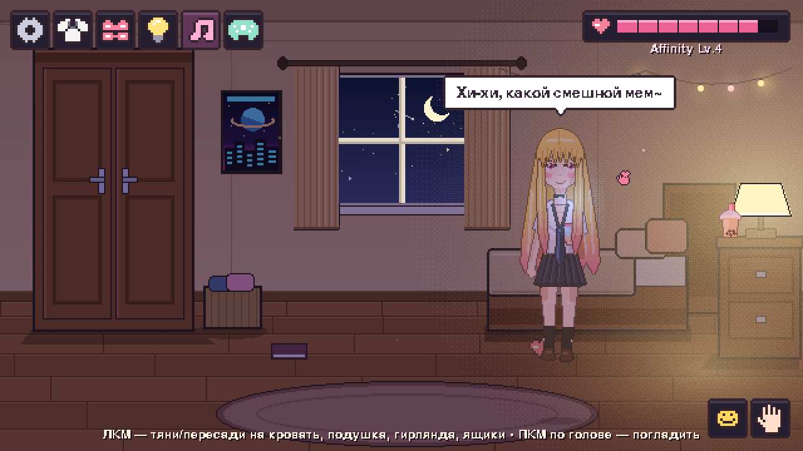
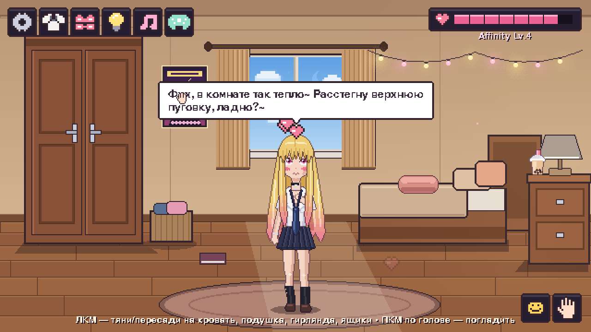
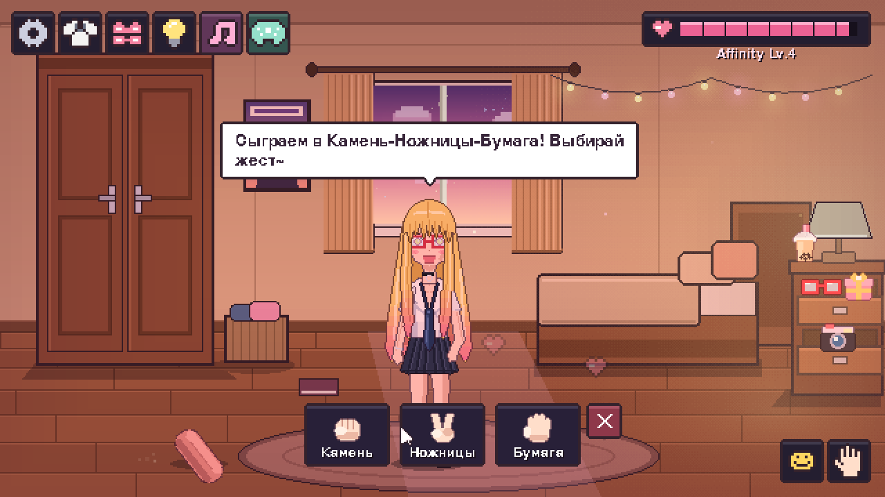

# Pixel Room — Marin Kitagawa (`v0.4-beta` — Living Room & Dynamic Affinity Update)

A cozy 16-bit interactive pixel-art desktop room & companion featuring **Marin Kitagawa** from *My Dress-Up Darling* (*Sono Bisque Doll wa Koi wo Suru*), built with Python + Pygame-CE (native `640×360` with pixel-perfect DPI-aware Nearest-Neighbor `1x`/`2x`/`3x` scaling, *sel-out* colored outlines, Bayer-dithered lighting, and clamped multi-layer spring-damper physics).

> **Download Windows Standalone `.exe` (No Python required):** grab `PixelRoom.exe` directly from the **[Releases](../../releases)** tab!
>
> *Unofficial non-commercial fan project. Marin Kitagawa and My Dress-Up Darling belong to Shinichi Fukuda / Square Enix.*

---

## Screenshots

| Bed Sitting, Phone Glow & Bayer-Dithered Night | Canon Relaxed V-Collar & Living Window | Romantic Glow, Open Drawers & RPS Minigame |
| :---: | :---: | :---: |
|  |  |  |

---

## Controls

- **LMB (Drag / Pull / Drop on Bed / Toss):** grab & toss Marin — or **drop her onto the bed** so she sits dangling her legs with her smartphone! Pull her arms, hair strands, tie, skirt, or cheek like elastic springs; throw the bed pillow (**throw it 2–3 times and she catches it & throws it back!**); feed bubble tea; or drag **cosplay glasses**, the **candy/gift box**, and the **retro camera** out of the nightstand drawers.
- **RMB (Hold & Move on Head):** gentle headpat with a custom pixel heart-hand cursor — her head tilts toward you, eyes close happily, hearts float up, and both Mood & **Affinity** grow.
- **Click Room Objects (with 1px hover outlines):** toggle hanging **Fairy Lights**, smoothly slide window **curtains**, toggle the **table lamp**, open the **wardrobe** (5 outfits), swap detailed **wall posters** (3 designs), open **nightstand drawers**, bounce the **laundry basket**, or flip the **floor manga**.
- **Corner Icons:** Settings (`0–150%` physics, volume, *Always on Top*, **Free Life AI toggle**, window scale, Reset Pose, Reset Progress), Wardrobe (5 outfits), Accessories (Cosplay Glasses / Cat Ears), Lighting (incl. **Romantic Glow**), **16-bit Lo-Fi Music Player**, **Rock-Paper-Scissors Minigame**, 10-Emotion switcher, and Wave.

---

## What's New in `v0.4-beta`

- **Living Room AI Routine ("Свободная жизнь"):** Marin now lives naturally in her room (toggleable in Settings, ON by default) — walking around, sitting on the bed dangling her legs with a glowing smartphone (whose soft cyan Bayer-dithered light illuminates her face at night), crouching to read manga with page-flips, watching drifting clouds & shooting stars at the window, checking her hair by the wardrobe, sipping bubble tea, or napping on the bed in pitch darkness.
- **"Tease vs Care" Dynamic Reactions & Pillow Counter-Throw:** interrupting her reading/phone or turning off the light while she reads makes her pout; turning the light on for her or bringing bubble tea / a gift to her on the bed earns bonus Affinity & warm lines! Throw the pillow at her twice in a row and she catches it and fires it right back at your cursor.
- **Canon Top-Button Collar Animation & Visual Fixes:** redesigned 5th outfit (**Canon Relaxed Shirt**) with a clear unbuttoned V-neck, lapels, collarbones & loosened navy tie; at **Affinity Lv.4+ & high Mood** she raises her hand and relaxes her top collar button (and buttons it back if teased too much!). Shrunk earrings to dainty 1–2px silver glints, fixed Windows DPI scaling (zero black strips), removed the stray rug artifact, and aligned the top-right Mood/Affinity HUD cleanly above the fairy lights.
- **16-bit Graphics, Living Window & Built-in Lo-Fi Player:** replaced flat light circles with **4×4 Bayer-dithered** halos for the fairy lights, desk lamp (with warm floor/wall bounce), and phone screen; added live drifting clouds, twinkling stars & shooting stars behind window mullions; redesigned all 3 wall posters in detailed 16-bit art; and added a click-free **16-bit Lo-Fi chill music loop** toggle.
- **Indie UX Polish:** crisp **1px hover outlines** on every interactive room object, **custom 16-bit pixel cursors** (`arrow`, `hand_open`, `hand_grab`, `hand_heart`), wrapped speech bubbles, smooth alpha-fading Settings modal, clamped `dt <= 0.05`, and corruption-proof `SaveManager`.

---

## Run from Source

```bash
pip install -r requirements.txt
python generate_assets.py
python pixelroom.py
```

To build a single-file Windows `.exe`:

```bash
python build.py
```
